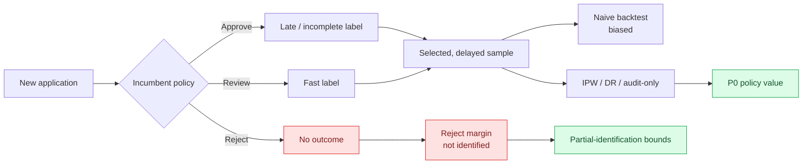

<div align="center">

# Onboarding Audit

**Audit-ready evaluation of account-opening fraud policies under selective and delayed labels.**

[](https://www.python.org/)
[](LICENSE)
[](tests/)
[](CHANGELOG.md)
[](docs/ROADMAP.md)

*A measurement layer for the question every onboarding team asks:*
**if we change the policy, will it catch more fraud without rejecting more good customers?**

[The problem](#the-problem) · [Headline results](#headline-results) · [Quickstart](#quickstart) · [Research design](#research-design) · [Documentation](#documentation) · [Roadmap](#roadmap)

</div>

---

> **Status:** `v0.2.1` research pilot. **47 tests pass.** The documentation is
> research-ready; the paper is not drafted. This is a simulation on public
> synthetic data — **not** a production system, **not** a Philippine bank
> deployment, and **not** a causal claim.

## Why this exists

Every bank and e-wallet makes the same decision: **approve, review, or reject** a
new account. The current policy decides which applications get a fast manual
review and which are approved and only sometimes labeled later. Rejected
applicants are never observed. The data used to test a new policy is therefore
selected by the old policy.

A normal backtest on the labeled data answers a different question. In this
project's simulation, it **overstated cost by 112–278%** and ranked the better
model **below** the incumbent — the naive evaluation would reject the better
policy.

This repository builds the missing measurement layer: a decision-log schema,
selection- and delay-aware estimators, a capacity-constrained review model, a
defensible audit design, and an audit-ready policy-change memo. It is tested
on the public **BAF account-opening benchmark** with known ground truth.

## The problem in one picture



**Green:** the project's output — a `P0` estimate and full-population bounds.
**Red:** structurally unobserved. The project's job is to be explicit about
which is which.

## At a glance

| Item | Detail |
|---|---|
| **Decision** | Approve / review / reject a new account application |
| **Primary estimand** | Policy value on `P0` — the logging non-rejected population |
| **Reject margin** | Partial-identification bounds, not a point estimate |
| **Estimators** | Naive, IPW-HT, IPW-Hájek, doubly robust, audit-only, bounds |
| **Propensity modes** | Oracle, action-level estimated, noisy, covariate |
| **Benchmark** | BAF account-opening test window: 227,491 applications, 1.2576% fraud |
| **Audit design** | Random post-hoc verification of approved applications + shadow scoring |
| **Interface** | Python package + `pilot`, `report`, `sensitivity`, `validate` CLI |
| **Status** | v0.2.1 research pilot · 47 tests · not production |

## Headline results

Measured on the BAF account-opening test window, 100 replications for the main
scenario and 50 for the sweeps and sensitivity studies.

| Finding | Result | Reading |
|---|---|---|
| Naive evaluation bias | **+111.6% to +278.5%** | relative bias across four policies |
| Naive ranking | **1.00 / 0%** | mean pairwise inversions / P(select true best) |
| Doubly robust (DR) | **0.94% / 96.0%** | max relative bias / mean coverage |
| IPW | **1.18% / 95.0%** | max relative bias / mean coverage |
| Audit-only at 1% | **2.98% / 84.5% / 1,271** | max bias / coverage / mean ESS |
| Outcome-dependent labels | audit-only **−2.37% to −1.98%**; IPW **+43.9% to +368.3%**; DR **+596.4% to +1301.5%** | relative bias |
| Reject-margin bounds | widest **0.009942**; incumbent coverage **35%** | width / coverage of true full value — **not** a confidence interval |
| Estimated action-level `e` | DR **2.67% / 91.0%**; IPW **11.19% / 73.0%** | max relative bias / mean coverage |
| Covariate-dependent observation | action IPW **67.52%**, DR **21.25%**; covariate model **1.97% / 2.48%** (delay 0.5) and **3.35% / 3.68%** (delay 45); coverage **89–91.5%** | relative bias; coverage is reported separately |

> **Caveat:** these are simulation results on public synthetic data, not a
> production estimate. The cost matrix is a normalized assumption. The covariate
> model is a logistic approximation, and heavy weights can undercover the
> interval. Every public number traces to
> [`reports/pilot.json`](reports/pilot.json) or
> [`reports/propensity_sensitivity.json`](reports/propensity_sensitivity.json)
> and appears in [`docs/CLAIMS.md`](docs/CLAIMS.md).

## What you can do today

| Command | What it does | Output |
|---|---|---|
| `onboarding-audit validate` | Check a decision log against the schema and report estimator readiness | Console / JSON diagnostics |
| `onboarding-audit report` | Evaluate a candidate policy from a log + candidate scores | `report.md` + `report.json` |
| `onboarding-audit pilot` | Run the full configured BAF benchmark (22 scenarios) | `pilot.md` + `pilot.json` |
| `onboarding-audit sensitivity` | Run the 11 propensity and covariate sensitivity scenarios | `propensity_sensitivity.md` + `.json` |

## Quickstart

```bash
git clone https://github.com/kira-ml/onboarding-audit.git
cd onboarding-audit
python -m venv .venv
source .venv/bin/activate          # Windows: .venv\Scripts\activate
pip install -e ".[dev]"

# 1. Run the test suite
pytest -q
```

### Explore the CLI without the pilot data

```bash
# Validate the synthetic sample log
onboarding-audit validate --log examples/sample_log.csv

# Generate an audit-ready memo from the sample log
onboarding-audit report \
  --log examples/sample_log.csv \
  --candidate examples/sample_candidate.csv \
  --config configs/pilot.yaml \
  --capacity 0.10 \
  --out reports/sample_report
```

The sample log is a **20-row schema/CLI smoke example**, not a research result.
The generated memo is `reports/sample_report/report.md`.

### Reproduce the benchmark

The BAF test file is **local and gitignored** (see [`docs/DATA.md`](docs/DATA.md)):

```bash
# ~19 min CPU, ~31 min wall-clock on the reference machine
onboarding-audit pilot --config configs/pilot.yaml --out reports

# ~16 min on the reference machine
onboarding-audit sensitivity --config configs/pilot.yaml --out reports --reps 50
```

## How it works

| Layer | What it does | Where |
|---|---|---|
| **1. Log** | Record the decision, observation, and label fields the evaluation needs | [`docs/SCHEMA.md`](docs/SCHEMA.md) |
| **2. Estimate** | Build capacity-constrained policies; estimate `P0` with naive, IPW, DR, or bounds; estimate the approved population with audit-only | `src/onboarding_audit/estimators.py` |
| **3. Audit** | Design a defensible post-hoc verification sample and shadow scoring | [`docs/AUDIT_DESIGN.md`](docs/AUDIT_DESIGN.md) |
| **4. Decide** | Write a memo that separates measured, assumed, and unverifiable claims | `src/onboarding_audit/report.py` |

The core design choice is the **estimand split**:

- **`P0`** — applications the incumbent did not reject. This is the part the log
  can identify under positivity and no unmeasured confounding of observation.
- **Reject margin** — applications the incumbent rejected. Their outcome is never
  observed, so the honest output is a **partial-identification interval**, not a
  point estimate.

## Project structure

```text
onboarding-audit/
├── src/onboarding_audit/
│   ├── config.py          # typed YAML configuration
│   ├── data.py            # BAF frame loading, decision days, feature scaling
│   ├── policies.py        # approve/review/reject + review capacity
│   ├── observation.py     # selection, delay, audit, label draws
│   ├── propensity.py      # action-level, noisy, and covariate e
│   ├── estimators.py      # naive, IPW-HT, IPW-Hájek, DR, audit-only, bounds
│   ├── metrics.py         # bias, RMSE, coverage, ESS, ranking, bounds
│   ├── pilot.py           # scenario runner + pilot report
│   ├── sensitivity.py     # propensity/covariate sensitivity
│   ├── report.py          # arbitrary-log report + memo
│   ├── schema.py          # decision-log validation
│   └── cli.py             # pilot / report / sensitivity / validate
├── configs/pilot.yaml     # pre-registered pilot configuration
├── docs/                  # research, methods, schema, audit, engineering
├── reports/               # committed pilot and sensitivity outputs
├── tests/                 # 47 tests, including negative controls
├── examples/              # synthetic log + CLI walkthrough
├── paper/                 # research notes; not a paper draft
├── data/                  # local processed BAF file (gitignored)
├── pyproject.toml
├── CITATION.cff
└── LICENSE
```

## Research design

| Component | Design |
|---|---|
| **Primary estimand** | `V_P0(pi) = E[C(pi(X), Y) \| i in P0]` — policy value on the logging non-rejected population |
| **Secondary estimands** | Approved-population value (audit-only); full-population partial-identification bounds |
| **Identification** | Consistency, positivity, no unmeasured confounding of observation, a credible observation model, a stable cost model, no interference |
| **Estimators** | Naive, IPW-HT, IPW-Hájek, doubly robust (cross-fitted outcome model), audit-only, bounds |
| **Propensity modes** | Oracle (benchmark isolation), action-level estimated, lognormal noise, cross-fitted per-action covariate model |
| **Audit** | Random post-hoc verification of approved applications; shadow scoring; **no random approvals/rejections** |
| **Metrics** | Relative bias, RMSE, coverage, ESS, max weight, rank inversions, P(select true best), cost of misranking, bounds width |
| **Stress tests** | Audit size 0–2%, review capacity 1–10%, delay 0.5–90 days, false-reject cost 0.02–0.50, outcome-dependent labels, covariate-dependent observation |

### Why this is not just another fraud model

| Typical fraud project | This project |
|---|---|
| Trains a classifier | Evaluates a **decision policy** |
| Reports AUC / F1 | Reports **policy value, bias, coverage, ranking** |
| Treats the labeled sample as random | Models **selection, delay, and capacity** |
| Optimizes accuracy | Optimizes **cost under a review budget** |
| Reports a point estimate | Reports **`P0` plus bounds for the reject margin** |
| Treats the audit as an afterthought | **Designs the audit** that identifies the approved margin |
| Hides assumptions | Publishes a **claim ledger and threats register** |

The contribution is the applied measurement layer and the identification
discipline, not a new estimator. The closest work is mapped in
[`docs/RELATED_WORK.md`](docs/RELATED_WORK.md).

## What is implemented vs planned

| Area | Status | Notes |
|---|---|---|
| Decision-log schema + validator | **Implemented** | Extends BSP 1213's 11 fields; `validate` command |
| Cost-sensitive policy construction | **Implemented** | Approve/review/reject with a hard review capacity |
| Observation model | **Implemented** | Action-dependent, delay/censoring, audit, outcome-dependent, covariate-dependent |
| Estimators | **Implemented** | Naive, IPW-HT, IPW-Hájek, DR, audit-only, bounds |
| Propensity estimation | **Implemented** | Action-level, noisy, and covariate models |
| Pilot benchmark | **Implemented** | 22 configured scenarios (13 core + 9 sensitivity), 1,150 replications |
| Propensity/covariate sensitivity | **Implemented** | 11 scenarios, 550 replications |
| Arbitrary-log report + memo | **Implemented** | `report` command with `--propensity-model covariate` |
| Documentation set | **Implemented** | Methods, results, claims, threats, decisions, reproducibility, architecture, testing |
| Test suite | **Implemented** | 47 tests, including negative controls |
| FiFAR capacity/analyst layer | **Planned** | Richer review-queue and analyst model |
| Real bank / Philippine log | **Planned** | Partner needed; the public benchmark is the current evidence |
| Bootstrap / randomization inference | **Planned** | Heavy-tail coverage in the covariate scenarios |
| External readers / red team | **Planned** | Before public release |
| Paper draft / arXiv | **Planned** | `paper/` contains research notes only |
| Transaction-fraud extension | **Planned** | Separate scope; not evaluated here |
| Fairness diagnostics | **Planned** | Schema has segment fields; the pilot does not evaluate fairness |
| Production integration | **Out of scope** | Not a vendor replacement or a production approval system |

## Limitations and non-claims

| Limitation | What it means |
|---|---|
| **Simulation on BAF** | Public synthetic data; the results are a benchmark, not a production estimate |
| **No Philippine bank data** | The local hook is motivational; the cost, capacity, and delay parameters are not calibrated to a specific institution |
| **Cost matrix is assumed** | Normalized and sensitivity-tested, not a bank's accounting |
| **Reject margin is bounded** | Not point-identified; the bounds are **not** confidence intervals |
| **Covariate model is logistic** | An approximation; heavy-tailed weights can undercover the interval |
| **No causal deployment claim** | Policy value under a stated observation model, not a live A/B test |
| **Audit requires legal/risk review** | Post-hoc verification and shadow scoring; no random approvals or rejections |
| **Not a fraud detector** | The project evaluates policies; it does not build a classifier |

## Documentation

| Start here | Why |
|---|---|
| [`docs/PROBLEM.md`](docs/PROBLEM.md) | The evidence-backed problem brief and the Philippine context |
| [`docs/METHODS.md`](docs/METHODS.md) | Estimand, identification, estimators, simulation, metrics |
| [`docs/RESULTS.md`](docs/RESULTS.md) | Consolidated measured findings and H1–H6 verdicts |
| [`docs/CLAIMS.md`](docs/CLAIMS.md) | The claim ledger: what may be said, with evidence |
| [`docs/THREATS.md`](docs/THREATS.md) | The strongest counter-case and mitigations |
| [`docs/SCHEMA.md`](docs/SCHEMA.md) | The decision-log schema |
| [`docs/AUDIT_DESIGN.md`](docs/AUDIT_DESIGN.md) | The compliant audit design and sample-size guidance |
| [`docs/REPORT_USAGE.md`](docs/REPORT_USAGE.md) | How to run and read the arbitrary-log report |
| [`docs/REPRODUCIBILITY.md`](docs/REPRODUCIBILITY.md) | Environment, data, commands, seeds, outputs |
| [`docs/ARCHITECTURE.md`](docs/ARCHITECTURE.md) | Code map, data flow, invariants, extension points |
| [`docs/TESTING.md`](docs/TESTING.md) | Test strategy, coverage, gaps |
| [`docs/FAQ.md`](docs/FAQ.md) | Practitioner, researcher, and interviewer questions |
| [`docs/LEARNING_GUIDE.md`](docs/LEARNING_GUIDE.md) | Plain-English concept map, practice set, and self-test |
| [`docs/README.md`](docs/README.md) | The full documentation index and reading paths |

Generated outputs: [`reports/pilot.md`](reports/pilot.md) and
[`reports/propensity_sensitivity.md`](reports/propensity_sensitivity.md).
Research notes: [`paper/README.md`](paper/README.md).

## Roadmap

| Milestone | Status | Focus |
|---|---|---|
| **v0.1 — Pilot** | Complete | Problem, schema, estimators, 700-replication benchmark |
| **v0.2 — Usable tool** | Complete | Arbitrary-log report, propensity and covariate sensitivity |
| **v0.2.1 — Documentation freeze** | Complete | Canonical research and technical documentation |
| **v0.3 — Research** | Next | Paper draft, second dataset, bootstrap intervals, independent red team |
| **v1.0 — Release** | Later | Public release, arXiv, external readers, application package |

See [`docs/ROADMAP.md`](docs/ROADMAP.md) for the review dates and out-of-scope
items.

## Contributing

This is a research repository. The contribution rules are designed to protect
the credibility of the claims, not just the code.

- **No new headline without pre-registration.**
- **Every public number traces to a committed artifact** and appears in
  [`docs/CLAIMS.md`](docs/CLAIMS.md).
- **No label leakage.** Pre-decision features only.
- **No causal deployment claim.** The estimand is policy value under a stated
  observation model.
- **No random approvals/rejections.** Use post-hoc verification and shadow
  scoring.
- **No PII.** Use public or synthetic data.

Read [`CONTRIBUTING.md`](CONTRIBUTING.md) before opening a pull request.

## Citation

If you use this project, cite the software via [`CITATION.cff`](CITATION.cff):

```bibtex
@software{Talingting_Onboarding_Audit_2026,
  author  = {Talingting, Ken Ira Lacson},
  title   = {Onboarding Audit: Audit-Ready Evaluation of Account-Opening Fraud Policies under Selective and Delayed Labels},
  version = {0.2.1},
  year    = {2026},
  license = {MIT},
  url     = {https://github.com/kira-ml/onboarding-audit}
}
```

## License

MIT. See [`LICENSE`](LICENSE).

## Acknowledgements

- The **Bank Account Fraud (BAF)** dataset: Jesus et al., NeurIPS 2022,
  arXiv:2211.13358.
- The open-source scientific Python stack: NumPy, pandas, SciPy, scikit-learn,
  PyArrow, PyYAML, and pytest.
- Public BSP, AFASA, and NPC documents that inform the regulatory mapping. This
  project is not legal advice.

---

<div align="center">

**A measurement layer for onboarding fraud decisions — built to be reproducible,
auditable, and honest about what the data cannot identify.**

</div>
